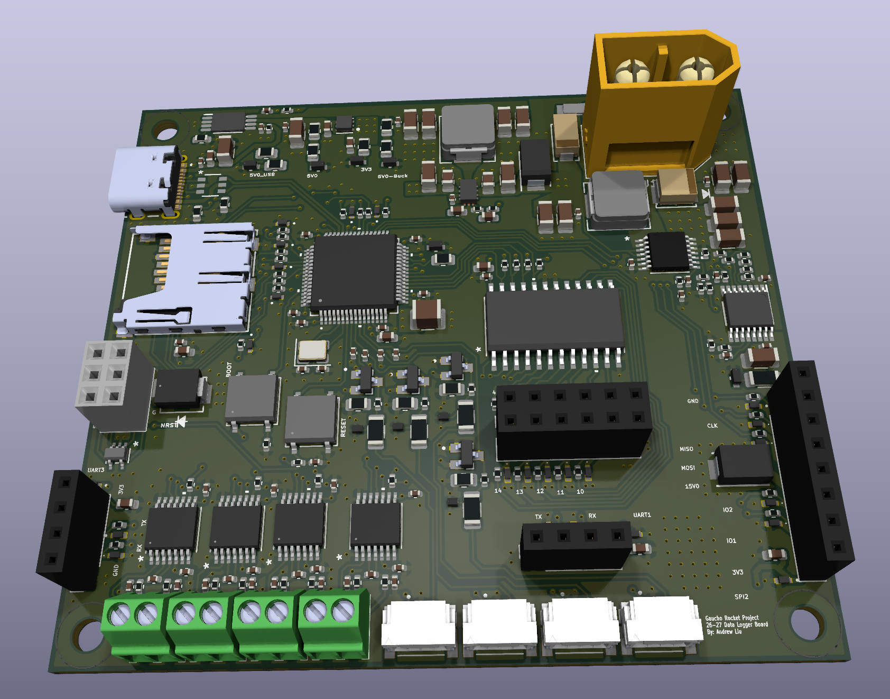

# DAQ Module — Sensor Data Logger

A compact sensor logging board for the **Gaucho Rocket Project (2026–27)**, designed by **Andrew Liu** at UC Santa Barbara. It replaces a perfboard-based logging system with a dedicated PCB for collecting rocket temperature and pressure data, with connections for future telemetry and sensor expansion.

## Key features

| Feature | Details |
| --- | --- |
| Microcontroller | STM32L496RET6 |
| Temperature | Four MAX31856 thermocouple interfaces |
| Pressure | Four 4–20 mA inputs with 130 Ω shunts and ADC protection |
| Storage | microSD via SDMMC |
| Connectivity | SPI expansion, two UART headers, USB-C, and SWD |
| Expansion | 4-to-16 decoder for SPI chip selection |
| Power | 9–12.6 V LiPo input; 15 V, 5 V, and 3.3 V rails; USB/battery power mux |
| Protection | Reverse-polarity protection, TVS/ESD protection, and a soft-start eFuse on the sensor supply |
| PCB | Four layers, approximately 78.68 × 71.02 mm |

## Design files

- [KiCad project](hotfire-board/Hotfire-Board.kicad_pro), [schematic](hotfire-board/Hotfire-Board.kicad_sch), and [PCB layout](hotfire-board/Hotfire-Board.kicad_pcb)
- [Custom symbols, footprints, and 3D models](hotfire-board/Project%20Libraries/)
- [Production exports](hotfire-board/production/): fabrication ZIP, BOM, and component placement files
- [Full design write-up](docs/Sensor_Data_Logger_Write_up.pdf): design rationale, power architecture, sensor interfaces, and PCB layout

Open the project in KiCad 10 or a compatible newer version. Keep the bundled libraries alongside the project so its relative library paths resolve.

This repository contains the hardware design and documentation. Firmware is not included; the write-up identifies board validation, firmware development, and telemetry integration as next steps.
